<picture>
  <source media="(prefers-color-scheme: dark)" srcset="assets/banner-dark.svg">
  
</picture>

  
  
  
  
  
  
  

## Featured work

<table>
<tr>
<td width="50%" valign="top" align="center">

<picture><source media="(prefers-color-scheme: dark)" srcset="assets/card-orbibot-dark.svg"></picture>

<b>OrbiBot V1</b> &nbsp;   

</td>
<td width="50%" valign="top" align="center">

<picture><source media="(prefers-color-scheme: dark)" srcset="assets/card-team-os-dark.svg"></picture>

<b>AI powered Team OS</b> &nbsp; 

</td>
</tr>
<tr>
<td width="50%" valign="top" align="center">

<picture><source media="(prefers-color-scheme: dark)" srcset="assets/card-robot-niko-dark.svg"></picture>

<b>Robot Niko</b> &nbsp;   

</td>
<td width="50%" valign="top" align="center">

<picture><source media="(prefers-color-scheme: dark)" srcset="assets/card-roboai-shop-dark.svg"></picture>

<b>RoboAI Shop</b> &nbsp; 

</td>
</tr>
</table>

### More I've built

<table>
<tr>
<td width="26%" valign="top"><b><a href="https://github.com/jewel-nath/agentic-robotics">agentic-robotics</a></b> WRITTEN 2026</td>
<td valign="top">29 skills that teach AI coding assistants to work on robots: ROS 2, Nav2, MoveIt 2, simulation and embedded code. Some material is adapted from two Apache 2.0 projects, credited in the repo</td>
</tr>
<tr>
<td width="26%" valign="top"><b><a href="https://github.com/jewel-nath/conveysort-arm">ConveySort-Arm</a></b> BUILT AND RUN 2024 · ROBOAI</td>
<td valign="top">A conveyor belt and a six-servo arm that sort blocks by size, with a webcam and OpenCV · <a href="https://doi.org/10.5281/zenodo.23741975">Report</a></td>
</tr>
<tr>
<td width="26%" valign="top"><b><a href="https://github.com/jewel-nath/envirobot">EnviroBot</a></b> BUILT 2024 · WITH MY TEAM</td>
<td valign="top">A rover with a robot arm that tells paper, plastic and other waste apart with YOLOv8, and picks it up · <a href="https://doi.org/10.5281/zenodo.23739491">Report</a></td>
</tr>
<tr>
<td width="26%" valign="top"><b><a href="https://github.com/jewel-nath/pi-car">Pi Car</a></b> BUILT 2022–23</td>
<td valign="top">A Raspberry Pi car that follows lines, avoids obstacles, and drives by keyboard, phone or live video</td>
</tr>
<tr>
<td width="26%" valign="top"><b><a href="https://github.com/jewel-nath/line-follower-robot">Line follower</a></b> BUILT 2023 · TEAM COU BOTS</td>
<td valign="top">An Arduino line follower with PID steering. Runner-up at EEE Day 2023, BAIUST</td>
</tr>
</table>

## Research

Technical reports on my robots, each with a DOI:

- **OrbiBot V1: A Mecanum Mobile Robot with Microcontroller-Level Real-Time
  Control, a ROS 2 Navigation Stack, and a Tool-Using LLM Agent - Design and
  Bench Evaluation** 
  J. Nath · 2026 · 
- **Robot Niko: A Life-Size 3D-Printed Humanoid Assistant on a Raspberry Pi -
  System Design and Build** 
  J. Nath, S. Mondol, T. Bin Parves, M. M. Khan Mahin, A. Chakraborty · 2026 · 
- **EnviroBot: A Mobile Robotic Arm that Detects and Picks Up Waste - Design,
  YOLOv8 Waste Detection and Prototype** 
  J. Nath, T. J. Toma, T. Akter · 2026 · 
- **ConveySort-Arm: A Low-Cost Vision-Guided Sorting Cell with a Conveyor Belt
  and a Six-Servo Arm - Design and Prototype** 
  J. Nath, S. A. Chowdhury · 2026 · 

[ORCID](https://orcid.org/0009-0002-6609-6378) ·
[Google Scholar](https://scholar.google.com/citations?user=kmQQHAQAAAAJ) ·
[ResearchGate](https://www.researchgate.net/profile/Jewel-Nath-2)

## Journey

<table>
<tr><th width="1%" align="left">When</th><th align="left">Role</th><th align="left">Where</th></tr>
<tr><td><code>2026&nbsp;–&#8288;&nbsp;now</code></td><td>Software Engineer</td><td>Orbitax</td></tr>
<tr><td><code>2026&nbsp;–&#8288;&nbsp;now</code></td><td>Technical Advisor</td><td>RoboAI</td></tr>
<tr><td><code>2024&nbsp;–&#8288;&nbsp;2026</code></td><td>Associate Software Engineer</td><td>Orbitax</td></tr>
<tr><td><code>2024&nbsp;–&#8288;&nbsp;2026</code></td><td>Robotics &amp; AI Automation Engineer, part time</td><td>RoboAI</td></tr>
<tr><td><code>2023&nbsp;–&#8288;&nbsp;2024</code></td><td>Founder &amp; CEO</td><td>RoboAI</td></tr>
<tr><td><code>2021&nbsp;–&#8288;&nbsp;2024</code></td><td>Programming &amp; Robotics Trainer, part time</td><td>School of Robotics, Cumilla</td></tr>
<tr><td><code>2019&nbsp;–&#8288;&nbsp;2023</code></td><td>Co-Founder &amp; Robotics Programmer</td><td>Quanta Robotics</td></tr>
<tr><td><code>2019&nbsp;–&#8288;&nbsp;2024</code></td><td>B.Sc. Engineering in ICT</td><td>Comilla University</td></tr>
</table>

## Problem solving &amp; awards

<table>
<tr><th width="1%" align="left">When</th><th align="left">What</th></tr>
<tr><td><code>2023</code></td><td>Runner-up, Line Follower Robot contest, BAIUST EEE Day, with team CoU Bots</td></tr>
<tr><td><code>2021</code></td><td>Top 100 of 1,051 ideas, Mujib 100 Idea Contest, with my team</td></tr>
<tr><td><code>2021</code></td><td><a href="https://codeforces.com/profile/codeCell">Codeforces</a> Specialist, max rating 1509, with 1,200+ problems solved</td></tr>
<tr><td><code>2021&nbsp;–&#8288;&nbsp;2022</code></td><td>Press and TV in Bangladesh on Robot Niko and Robot Blueberry</td></tr>
</table>

## Toolkit

<table>
<tr><th width="1%" align="left">Area</th><th align="left">Tools</th></tr>
<tr><td><b>Languages</b></td><td>C#, Python, TypeScript, JavaScript, C++</td></tr>
<tr><td><b>AI&nbsp;engineering</b></td><td>AI agents, MCP servers, LLM tool calling, RAG, structured outputs, Ollama, LiteLLM</td></tr>
<tr><td><b>AI&nbsp;dev&nbsp;tools</b></td><td>Claude Code (skills, subagents, rules), Codex, Cursor, AI code review, spec-driven development</td></tr>
<tr><td><b>Backend&nbsp;&amp;&nbsp;data</b></td><td>.NET 10, ASP.NET Core, CQRS, background workflows, Node.js, MongoDB, PostgreSQL, Supabase</td></tr>
<tr><td><b>Frontend</b></td><td>Angular, Next.js, Tailwind</td></tr>
<tr><td><b>Testing</b></td><td>Playwright, NUnit, pytest, Vitest</td></tr>
<tr><td><b>DevOps&nbsp;&amp;&nbsp;infra</b></td><td>Git, Linux, Docker, Vercel, Cloudflare R2, systemd services on Raspberry Pi</td></tr>
<tr><td><b>Robotics&nbsp;&amp;&nbsp;vision</b></td><td>ROS 2 Jazzy, Nav2, SLAM, robot_localization, MoveIt, URDF, RViz, Gazebo, MuJoCo; OpenCV, YOLOv8, MediaPipe, PyTorch</td></tr>
<tr><td><b>Embedded&nbsp;&amp;&nbsp;hardware</b></td><td>STM32 firmware, PID control, ESP32, Arduino, Raspberry Pi, KiCad, FreeCAD (Python-scripted), 3D printing</td></tr>
</table>

I post OrbiBot's build log on
<a href="https://www.youtube.com/@jewelnathdev">YouTube</a>,
<a href="https://www.linkedin.com/in/jewelnath/">LinkedIn</a> and
<a href="https://x.com/jewelnathdev">X</a>, one step of the build at a time.

