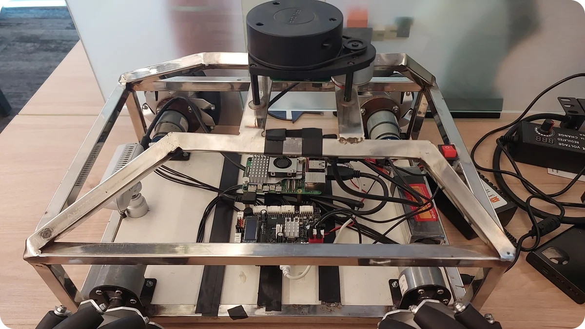
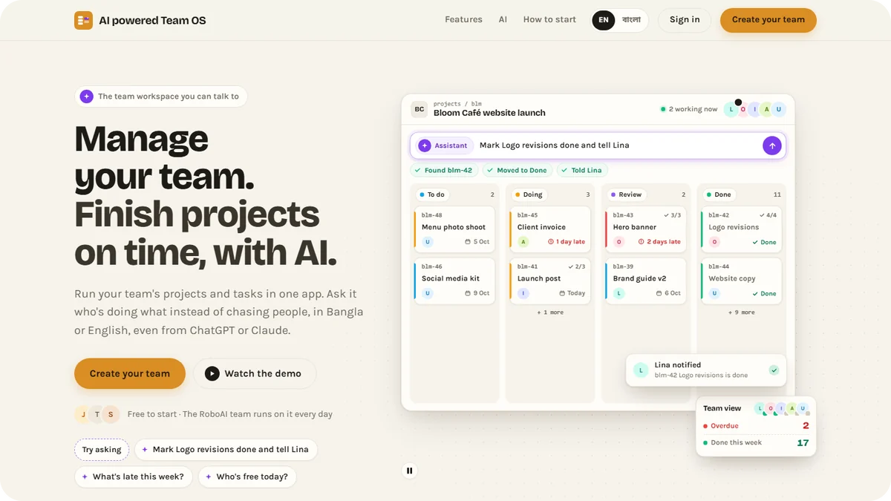
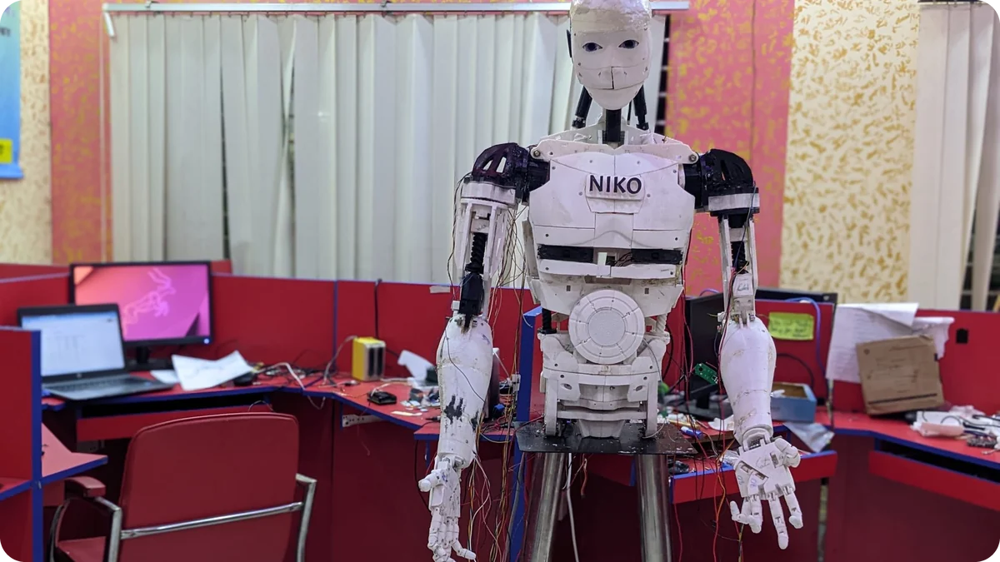
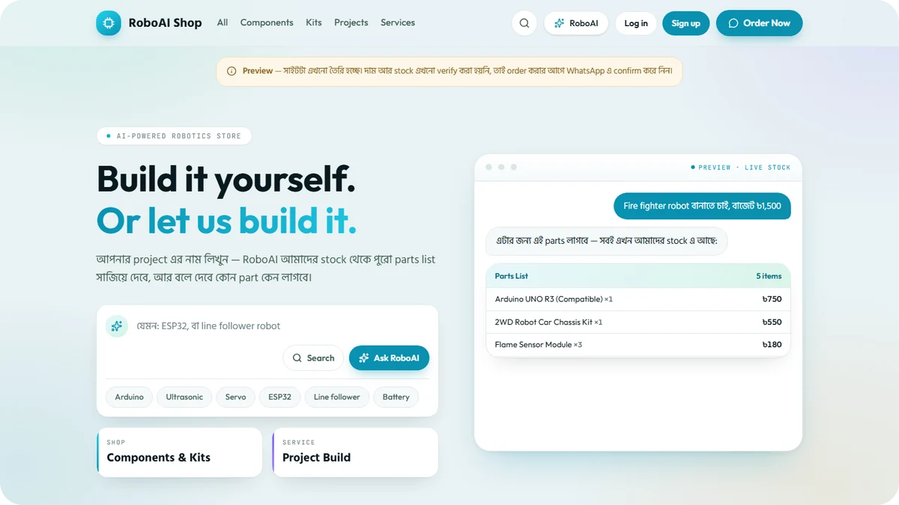

<picture>
  <source media="(prefers-color-scheme: dark)" srcset="assets/banner-dark.svg">
  
</picture>

  
  
  
  
  
  
  

I'm a software engineer at **Orbitax**, building .NET backend services for an
international tax compliance platform. Around that, I build AI agents and
automation, and put them on robots I build myself.

<table>
<tr>
<td width="33%" valign="top">

**Software at Orbitax** 
.NET backend for an international tax compliance platform

</td>
<td width="33%" valign="top">

**AI agents & automation** 
MCP servers and tool-using LLM agents, at RoboAI, the startup I founded and now advise

</td>
<td width="33%" valign="top">

**Robotics** 
OrbiBot, a ROS 2 robot I'm building in public, and Robot Niko, a life-size humanoid

</td>
</tr>
</table>

## Featured work

<table>
<tr>
<td width="50%" valign="top">

### [OrbiBot](https://github.com/jewel-nath/orbibot-v1)
MY ROBOT · BUILT 2025–2026

A mecanum robot I welded, wired and programmed: my own STM32 firmware,
LiDAR SLAM, Nav2 navigation, a web dashboard and an AI agent with 58 robot
tools.

`ROS 2 Jazzy` `C` `Python` `React` `MCP`

[Code](https://github.com/jewel-nath/orbibot-v1) · [Video](https://youtube.com/shorts/yCSsCJm5qBw) · [Report](https://doi.org/10.5281/zenodo.23696694)

</td>
<td width="50%" valign="top">

### [AI powered Team OS](https://teamos.site)
AI PRODUCT AT ROBOAI · LIVE

A team workspace that people and AI agents run together. Its MCP server has
158 tools, so ChatGPT and Claude can work inside it, and money actions wait
for a person to approve.

`Next.js` `TypeScript` `Supabase` `MCP` `OAuth 2.1`

[Live site](https://teamos.site)

</td>
</tr>
<tr>
<td width="50%" valign="top">

### [Robot Niko](https://github.com/jewel-nath/robot-niko)
HUMANOID ROBOT · BUILT 2022

A life-size, 3D-printed humanoid assistant in the InMoov design, built with
the team at Quanta Robotics. I worked on every part: the printing, the
assembly, the servo tuning, the arm motions and the software. It talks, and
greets people it knows with a handshake.

`Python` `Raspberry Pi` `OpenCV` `3D printing`

[Code](https://github.com/jewel-nath/robot-niko) · [Video](https://youtu.be/6iEj3AY1AlA) · [Report](https://doi.org/10.5281/zenodo.23719561)

</td>
<td width="50%" valign="top">

### [RoboAI Shop](https://shop.roboai.one)
AI PRODUCT AT ROBOAI · LIVE

A robotics parts store: describe the robot you want to build, and the AI
plans the parts list from the shop's catalogue. It never writes a price
itself.

`Next.js` `Supabase` `Gemini` `MCP`

[Live site](https://shop.roboai.one)

</td>
</tr>
</table>

### More I've built

| Project | What it is |
|---|---|
| [agentic-robotics](https://github.com/jewel-nath/agentic-robotics) | 29 skills that teach AI coding assistants ROS 2, navigation and embedded work, with material adapted from two Apache 2.0 projects, credited in the repo |
| [ConveySort-Arm](https://github.com/jewel-nath/conveysort-arm) | A six-servo arm and a conveyor belt that sort blocks by size with OpenCV |
| [EnviroBot](https://github.com/jewel-nath/envirobot) | A rover with an arm, built with my team at Comilla University, that finds waste with YOLOv8 and picks it up |
| [Pi Car](https://github.com/jewel-nath/pi-car) | A Raspberry Pi car: line following, obstacle avoidance, live-video driving |
| [Line follower](https://github.com/jewel-nath/line-follower-robot) | An Arduino PID line follower, runner-up at BAIUST EEE Day 2023 with team CoU Bots |

## Research

Technical reports on my robots, each with a DOI:

- **OrbiBot V1: A Mecanum Mobile Robot with Microcontroller-Level Real-Time
  Control, a ROS 2 Navigation Stack, and a Tool-Using LLM Agent - Design and
  Bench Evaluation** 
  J. Nath · 2026 · 
- **Robot Niko: A Life-Size 3D-Printed Humanoid Assistant on a Raspberry Pi -
  System Design and Build** 
  J. Nath, S. Mondol, T. Bin Parves, M. M. Khan Mahin, A. Chakraborty · 2026 · 

[ORCID](https://orcid.org/0009-0002-6609-6378) ·
[Google Scholar](https://scholar.google.com/citations?user=kmQQHAQAAAAJ) ·
[ResearchGate](https://www.researchgate.net/profile/Jewel-Nath-2)

## Journey

| When | Role | Where |
|---|---|---|
| 2026 – | Software Engineer | Orbitax |
| 2024 – 2026 | Associate Software Engineer | Orbitax |
| 2023 – | Founder & Technical Advisor | RoboAI |
| 2021 – 2024 | Programming & Robotics Trainer | School of Robotics, Cumilla |
| 2020 – 2023 | Co-Founder & Robotics Programmer | Quanta Robotics |
| 2019 – 2024 | B.Sc. Engineering in ICT | Comilla University |

## Problem solving & awards

| When | What |
|---|---|
| 2023 | Runner-up, Line Follower Robot contest, BAIUST EEE Day, with team CoU Bots |
| 2021 | Top 100 of 1,051 ideas, Mujib 100 Idea Contest, with my team |
| 2021 | [Codeforces](https://codeforces.com/profile/codeCell) Specialist, max rating 1509, with 1,200+ problems solved |
| 2021 – 2022 | Press and TV in Bangladesh on Robot Niko and Robot Blueberry |

## Toolkit

| Area | Tools |
|---|---|
| **AI** | MCP, Claude API, Gemini, Ollama, RAG, Claude Code |
| **Backend** | C#, .NET, ASP.NET Core, MongoDB, PostgreSQL |
| **Web** | TypeScript, Next.js, React, Angular, Supabase |
| **Robotics** | ROS 2, Nav2, MuJoCo, STM32, ESP32, Raspberry Pi, KiCad, FreeCAD |

Building OrbiBot in public on
<a href="https://www.youtube.com/@jewelnathdev">YouTube</a>,
<a href="https://www.linkedin.com/in/jewelnath/">LinkedIn</a> and
<a href="https://x.com/jewelnathdev">X</a>.

