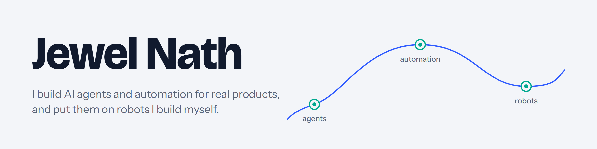
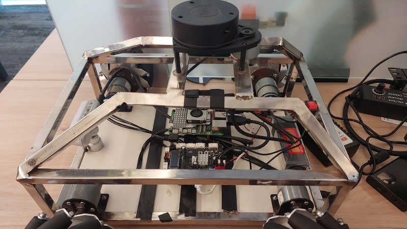
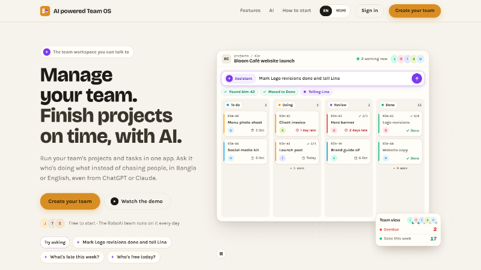
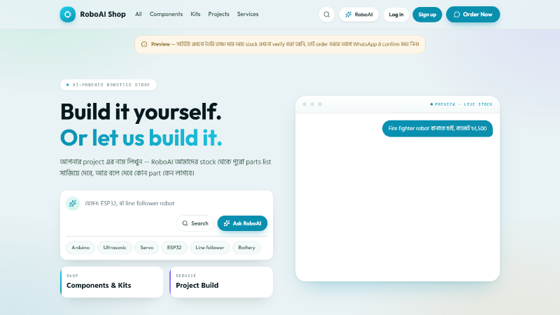
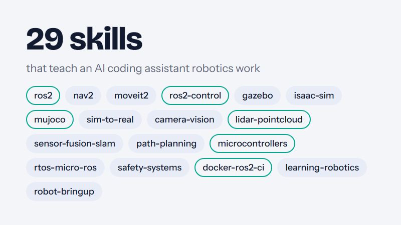
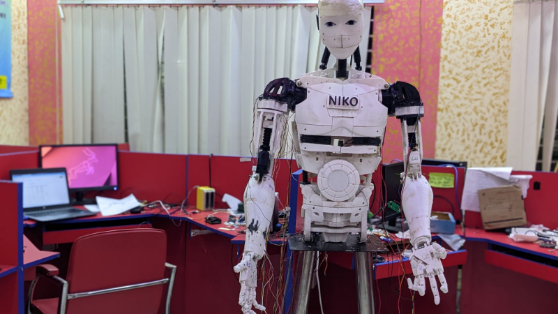
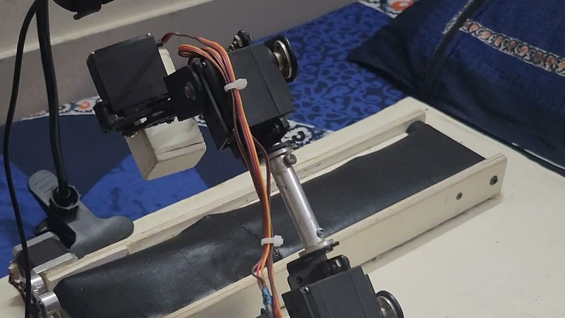

<picture>
  <source media="(prefers-color-scheme: dark)" srcset="assets/banner-dark.png">
  
</picture>

I'm a software engineer at Orbitax. Around it, I build AI agents,
automation and robots, including OrbiBot, and advise RoboAI, the startup I
founded.

- **Software Engineer at Orbitax:** .NET backend for an international tax
  compliance platform.
- **Founder & Technical Advisor at [RoboAI](https://roboai.one):** I
  founded it in 2023 and built its AI products, MCP servers and AI agents;
  my juniors run it now.
- **Building OrbiBot**, a ROS 2 robot, in public on
  [YouTube](https://www.youtube.com/@jewelnathdev),
  [LinkedIn](https://www.linkedin.com/in/jewelnath/) and
  [X](https://x.com/jewelnathdev).

## What I'm building

<table>
<tr>
<td width="50%" valign="top">

<h3><a href="https://github.com/jewel-nath/orbibot-v1">OrbiBot</a></h3>
A mecanum robot I welded, wired and programmed: my own STM32 firmware,
LiDAR SLAM, Nav2 navigation, a web dashboard and an AI agent with 58 robot
tools. ROS 2 Jazzy, C, Python, React, MCP.
</td>
<td width="50%" valign="top">

<h3><a href="https://teamos.site">AI powered Team OS</a></h3>
A team workspace that people and AI agents run together. Its MCP server
has 150+ tools, so claude.ai and ChatGPT can work inside it. Next.js,
TypeScript, Supabase, MCP, OAuth 2.1.
</td>
</tr>
<tr>
<td width="50%" valign="top">

<h3><a href="https://shop.roboai.one">RoboAI Shop</a></h3>
A robotics parts store where you describe a project and the AI plans the
parts list from the shop's catalogue. It never invents a price. Next.js, Supabase,
Gemini, MCP.
</td>
<td width="50%" valign="top">

<h3><a href="https://github.com/jewel-nath/agentic-robotics">agentic-robotics</a></h3>
29 skills that teach an AI coding assistant ROS 2, navigation, simulation
and embedded work, with adapted material from arpitg1304's
robotics-agent-skills and harunkurtdev's ros2-claude-code-template
(Apache 2.0). Markdown skills and a Python validator.
</td>
</tr>
</table>

## Robots I built before

<table>
<tr>
<td width="50%" valign="top">

<h3><a href="https://github.com/jewel-nath/robot-niko">Robot Niko</a></h3>
A life-size, 3D-printed humanoid assistant in the InMoov design. With the
team at Quanta Robotics, I did every part of it: the 3D printing, the
assembly, the servo tuning, the arm motions and the programming. It has a
wake word, spoken conversation, and face recognition that greets people
with a handshake (2022).
</td>
<td width="50%" valign="top">

<h3><a href="https://github.com/jewel-nath/conveysort-arm">ConveySort-Arm</a></h3>
A six-servo arm and a conveyor belt that sort blocks by size, with a
webcam, OpenCV and an Arduino (2024).
</td>
</tr>
</table>

Also: [EnviroBot](https://github.com/jewel-nath/envirobot), a rover with an
arm, built with a team at Comilla University, that finds waste with YOLOv8
and picks it up;
[Pi Car](https://github.com/jewel-nath/pi-car), a Raspberry Pi car with
several driving modes; and a
[line follower](https://github.com/jewel-nath/line-follower-robot), runner-up
at BAIUST EEE Day 2023 with team CoU Bots.

## Tools I use

**AI:** MCP, Claude API, Gemini, Ollama, Claude Code 
**Backend:** C#, .NET, ASP.NET Core, MongoDB, PostgreSQL, Node.js 
**Web:** TypeScript, Next.js, React, Angular, Supabase 
**Robotics:** ROS 2, Nav2, MuJoCo, STM32, ESP32, Raspberry Pi, KiCad, FreeCAD

## Find me

[jewelnath.dev](https://jewelnath.dev) ·
[LinkedIn](https://www.linkedin.com/in/jewelnath/) ·
[X](https://x.com/jewelnathdev) ·
[YouTube](https://www.youtube.com/@jewelnathdev)
